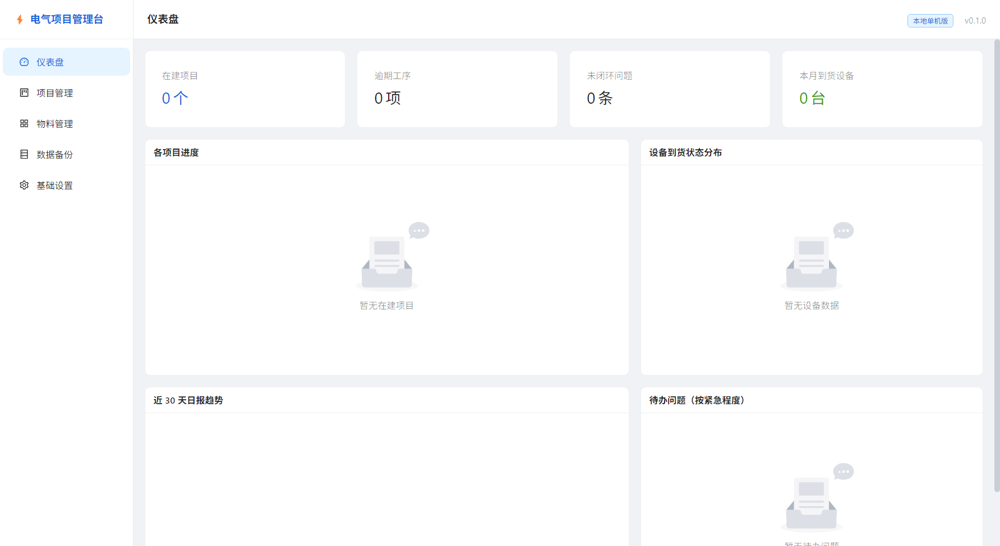
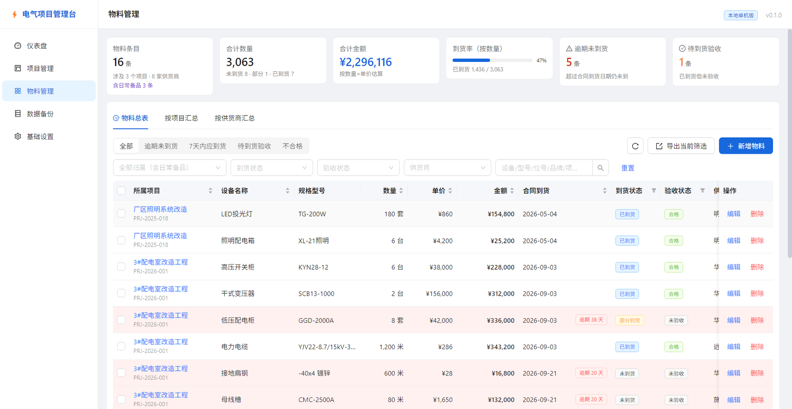
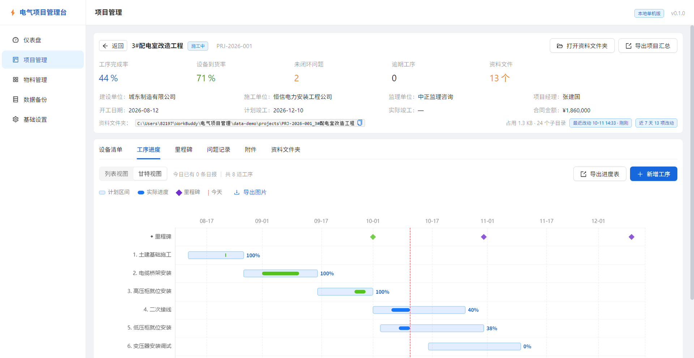
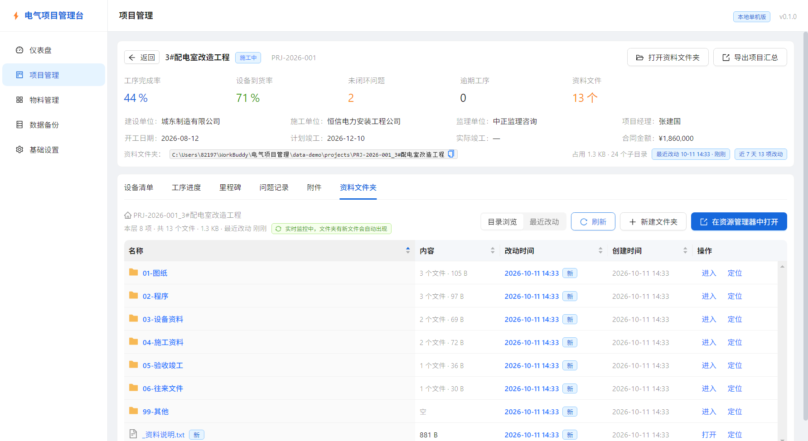

# 电气项目管理台

**Electric Project Workbench** — 面向电气安装工程现场的单机桌面工作台：
项目台账 + 设备物料 + 施工进度（含甘特图）+ 问题闭环 + 附件与工程资料文件夹。

纯本地运行，数据存在本机 SQLite 文件里，**不联网、不上传、不需要账号**。

技术栈：`Electron` · `React 18` · `TypeScript` · `Vite` · `Ant Design 5` · `ECharts` · `better-sqlite3`

---

## 界面预览

| 仪表盘 | 物料管理 · 跨项目总表 |
| :---: | :---: |
|  |  |

| 工序进度 · 甘特视图 | 项目资料文件夹 |
| :---: | :---: |
|  |  |

> 其余界面截图见 `docs/images/`：工序列表（`03-process.png`）、设备清单（`02-equipment.png`）。

---

## 一、快速开始（给使用者）

### 方式 A：下载已打包版本（推荐，无需装 Node）

到本仓库 **Releases** 页面下载安装包，或使用本地 `dist-exe/` 目录（需先自行构建）：

- **安装版**：双击 `电气项目管理台 Setup 0.1.0.exe`，按向导安装，会创建桌面与开始菜单快捷方式。
- **免安装版**：进入 `免安装版/` 文件夹，双击 `电气项目管理台.exe`。

> ⚠️ 仓库里**不含编译产物**（`node_modules/`、`dist/`、`dist-electron/`、`dist-exe/`、`release*/`
> 都已在 `.gitignore` 中忽略）。要拿到 exe，请先 `npm install` + `npm run build`，或 `npm run dist` 打包。

数据存放在 `%APPDATA%\electric-project-workbench\`，与程序分离，卸载不会丢数据。

### 方式 B：从源码运行

双击 **`启动.bat`** 即可（会显示诊断信息，出问题能看清原因）。

想要**不弹黑框**的干净启动，双击 **`启动(无窗口).vbs`**。

> 首次运行若提示"依赖未安装"，请打开命令行在项目目录执行一次：
> ```
> npm install --no-audit --no-fund
> npm run build
> ```
> 之后每次双击即可直接运行。

---

## 二、开发命令（给开发者）

```bash
npm install              # 安装依赖（首次）
npm run dev              # 开发模式，支持热更新
npm run build            # 类型检查 + 构建
npm run test:smoke       # 数据层规则测试（32 项，在 Electron 内运行）
npm run test:e2e         # 端到端业务链路测试（110 项，开发态）
npm run verify:pkg       # 端到端验证「打包后的 exe」（110 项，交付前必跑）
npm run dist             # 打包成 Windows 安装包 exe
npm run dist:dir         # 打包成免安装目录
npm run make:launcher    # 重新生成启动脚本（改过启动逻辑后）
```

> **`verify:pkg` 是交付前的最后一道关**。它直接启动 `release/win-unpacked/` 里的真实 exe
> 并跑完 110 项业务链路，能抓到开发态测不出的打包问题（缺依赖、路径错误、原生模块未带等）。
> 用法：`npm run verify:pkg`。
>
> 测试全程在 `data-test/` 沙箱里跑（`DATA_ROOT` + `PROJECT_FOLDER_ROOT` 两个环境变量），
> 用独立数据库和独立资料目录，跑完自动清理，不会污染开发库与真实资料盘。

产物位置：
- `dist/` — 前端界面
- `dist-electron/` — 主进程与 preload
- `release/` — 打包后的 exe（安装包 `电气项目管理台 Setup x.x.x.exe` + 免安装目录 `win-unpacked/`）
- `dist-exe/` — 已生成好的交付件副本（安装包 + 免安装版文件夹）

> ⚠️ **启动脚本用 GBK 编码保存**。Windows 的 cmd.exe 默认按 GBK 解析 `.bat`，
> 用 UTF-8 保存会导致中文乱码和命令解析错乱。修改启动脚本请用
> `npm run make:launcher` 重新生成，不要用编辑器直接改后存成 UTF-8。

> ⚠️ **测试必须在 Electron 内运行**。`better-sqlite3` 是原生模块，且已按
> Electron 的 ABI（MODULE_VERSION 130）编译，纯 Node（ABI 127）无法加载它。
> 因此 `test:smoke` 与 `e2e-verify.cjs` 都是以 Electron 作为宿主来跑断言的，
> 不要试图用 `node 脚本` 直接连数据库。若确有命令行场景需要，可临时执行
> `npx @electron/rebuild -f -w better-sqlite3 -v 33.4.11` 切到 Electron ABI。

> ⚠️ **打包时依赖只允许保留 `better-sqlite3`**。主进程产物会把无法打包的原生模块
> 保留为运行时 `require`，其余 npm 包（如 `xlsx`）必须由 Vite 打进 `main.cjs`。
> 若在 `vite.config.ts` 里把 `xlsx` 加进 `external`，打包后会因缺少 `node_modules/xlsx`
> 而启动即崩（报 `Cannot find module 'xlsx'`）。改依赖策略后请务必重新打包并实际启动验证。

> ⚠️ **打包后数据目录在 `%APPDATA%`**。安装版/免安装版启动后，数据库与附件存放于
> `C:\Users\<用户名>\AppData\Roaming\electric-project-workbench\`（`app.db`、`attachments/`）。
> 这是刻意为之：安装目录（可能在 `Program Files`）与 `app.asar` 均为只读，不能写数据。
> 开发态仍写在项目根 `data/`，方便调试。

---

## 三、用到的技术

| 层 | 技术 |
|---|---|
| 桌面壳 | Electron 33 |
| 界面 | React 18 + TypeScript + Vite 5 |
| 组件库 | Ant Design 5 |
| 图表 | ECharts |
| 数据库 | SQLite（better-sqlite3） |
| Excel | SheetJS |

---

## 四、数据存放位置

**开发态**（双击 `启动.bat` 从源码跑）：

| 内容 | 位置 |
|---|---|
| 数据库 | `data/app.db` |
| 附件/照片 | `data/attachments/{项目id}/` |
| 自动备份 | `data/backups/`（保留最近 30 份） |

**打包态**（安装版 / 免安装版）：

| 内容 | 位置 |
|---|---|
| 数据库 | `%APPDATA%\electric-project-workbench\app.db` |
| 附件/照片 | `%APPDATA%\electric-project-workbench\attachments\{项目id}\` |
| 自动备份 | `%APPDATA%\electric-project-workbench\backups\` |

> 完整路径形如 `C:\Users\<用户名>\AppData\Roaming\electric-project-workbench\`。
> 在资源管理器地址栏粘贴 `%APPDATA%\electric-project-workbench` 可直接打开。

**换电脑 / 迁移**：
- 开发态：复制整个项目文件夹，数据跟着走。
- 打包态：在应用内用「数据备份」导出，再到新机器「数据备份 → 恢复」即可。
- 资料文件夹（图纸、程序等）是普通文件夹，直接复制到新机器的资料根目录即可。

---

## 四之二、项目资料文件夹（图纸 / 程序存放处）

台账里的数据（设备、工序、日报）存在 SQLite 里；但**图纸、PLC 程序、说明书、试验报告**
这类东西是文件，塞进数据库没意义。所以每个项目都配一个**独立资料文件夹**：

### 建在哪

根目录默认 `D:\电气项目资料`（无 D 盘则退回「我的文档\电气项目资料」），
可在 **基础设置 → 项目资料文件夹** 里随时改。

新建项目时自动生成：

```
D:\电气项目资料\
└─ PRJ-2026-001_3#配电室改造工程\
   ├─ 01-图纸\
   │  ├─ 设计图纸\
   │  ├─ 变更图纸\
   │  └─ 竣工图纸\
   ├─ 02-程序\
   │  ├─ PLC程序\
   │  ├─ 触摸屏组态\
   │  └─ 变频器与仪表参数\
   ├─ 03-设备资料\
   │  ├─ 设备清单\
   │  ├─ 说明书与样本\
   │  └─ 合格证与检测报告\
   ├─ 04-施工资料\
   │  ├─ 施工方案与技术交底\
   │  ├─ 现场照片\
   │  └─ 隐蔽工程记录\
   ├─ 05-验收竣工\
   │  ├─ 试验报告\
   │  ├─ 验收单\
   │  └─ 竣工资料\
   ├─ 06-往来文件\
   │  ├─ 收文\
   │  └─ 发文\
   ├─ 99-其他\
   └─ _资料说明.txt          （说明各目录该放什么，可删）
```

文件夹名为 `项目编号_项目名称`（编号在前，便于按工程排序）。结构不用照搬 ——
**基础设置** 里的模板可以直接编辑（每行一个目录，行首缩进两格表示子目录），改完点保存，
之后新建的项目就按新结构生成。

### 怎么用

| 入口 | 位置 |
|---|---|
| 打开整个项目资料夹 | 项目详情页右上角 **「打开资料文件夹」** |
| 项目列表快捷打开 | 项目列表「操作」列的 **「资料」** 按钮 |
| 应用内浏览 | 项目详情 → **「资料文件夹」** 页签，支持进子目录、双击打开文件、新建文件夹 |
| 改根目录 / 补建 | **基础设置 → 项目资料文件夹** |

在应用内浏览时，双击文件用系统默认程序打开（`.dwg` 需要装了 CAD）；
「在资源管理器中打开」会直接调出 Windows 资源管理器，方便拖拽文件。

### 不用通过软件上传，文件直接丢进去就行

你完全可以在资源管理器里把图纸、程序丢进对应分类目录，软件**自己会认**：

- 列表是**实时读盘**的 —— 文件夹里有什么就显示什么，不是软件另存的一份台账。
- 页面顶部会显示 **实时监控中**：只要你还停在这一页，往文件夹里新建 / 拖入 / 覆盖 / 删除文件，
  一两秒后列表自动刷新，并提示「检测到文件夹有变化（N 处）」。
- 每个文件都带 **改动时间**（7 天内的标「新」）和 **创建时间**，点表头可按名称 / 大小 / 时间排序。
- 目录行直接显示「里面有几个文件 · 占多大 · 最近一次改动是什么时候」，
  不用点进去就知道哪个分类刚有新东西。
- 切到 **「最近改动」** 视图：整个项目扫一遍，按改动时间倒序列出最近动过的文件，
  并标出它属于哪个分类（支持 全部 / 近 7 天 / 近 30 天 切换）。
  隔几天回来忘了东西放哪，看这一屏就够了。

项目详情页头部也会同步显示「资料文件 N 个」以及「占用 … · 最近改动 … · 近 7 天 N 项改动」。

> **实时监控**只在打开该页时生效（用系统级目录监视实现）。应用没开或没进这一页时，
> 文件当然还在原地，下次打开列表会重新读盘，一样能看到最新内容。

### 几条约定

- **软件不管文件**：不做文件托管、不复制、不删除。你在资源管理器里怎么整理都行，
  软件只负责建目录、打开目录、列目录。
- **改了项目编号或名称**，如果文件夹还是自动生成的命名，会跟着一起改名；你自己改过名的目录不动。
- **删除项目时资料文件夹一律保留** —— 里面是你自己的图纸和程序，软件不会连带删除。
  想清理请手动去资源管理器删。
- **文件夹被挪走或删掉**了也不怕：下次从应用点「打开资料文件夹」会按当前根目录重新生成。
- **老项目**：升级前建的项目还没文件夹，去 **基础设置** 点「为已有项目补建文件夹」一次性补齐。

---

## 四之三、总物料管理（跨项目物料台账）

左侧导航 **物料管理**（`/materials`）：把所有项目的设备物料汇总到一屏来看。

### 顶部六个指标
物料条目 / 合计数量 / 合计金额 / 到货率（按数量）/ **逾期未到货** / **待到货验收**。
后两个可以直接点，一键切到对应监控清单。

### 三个页签

| 页签 | 用途 |
|---|---|
| **物料总表** | 全项目物料一张表，带「所属项目」列。可按项目、到货状态、验收状态、供货商筛选，可搜索，按任意列排序 |
| **按项目汇总** | 每个项目的物料条目数、总数量、总金额、到货率进度条、未到货 / 逾期 / 待验收 / 不合格计数 |
| **按供货商汇总** | 按供货商聚合金额与风险条目 —— **催货就照这张表打电话** |

> 汇总页签只按「项目」这一维度收敛，与总表的快捷视图/状态筛选互不干扰，
> 避免出现「顶部指标被筛过、下方汇总却是全量」的口径矛盾。

### 到货监控（快捷视图）
总表上方一排快捷视图，是日常最常用的入口：

- **逾期未到货** —— 有合同到货日期、已经过期、却还没到货。总表里这些行**整行标红**，
  并在合同到货列挂「逾期 N 天」标签。
- **7 天内应到货** —— 该催货了，挂「N 天 / 今日应到」标签。
- **待到货验收** —— 货到了但还没验收。
- **不合格** —— 验收结论为不合格的条目，整行标黄。

### 能直接改，不用先进项目
- **跨项目编辑 / 删除**：总表里直接改任意项目的物料。
- **批量改状态**：勾选多条 → 批量改到货状态 / 验收状态（比如一批货今天到了，一次改完）。
  设为「已到货」不填日期时默认取今天。
- **批量删除**：勾选多条一次性删除。
- **新增物料**：弹窗里下拉选归属项目，直接录到对应项目下。
- **导出当前筛选**：导出的是"你现在看到的这批"，不是全量。

> **业务规则不会被批量操作绕过**：每条都单独跑一遍设备校验（如"未到货不能有验收结论"），
> 不合规的条目会被**跳过并列出原因**，其余照常更新 —— 避免一条不合法导致整批失败。

### 日常备品（暂时不归属任何项目）
有些物料是公共备件/库存，暂时不挂在哪个项目上。这类物料**直接把「所属项目」留空**（选第一项
「日常备品 · 不归属项目」）就能存进来：

- 总表里它们的「所属项目」显示紫色 **日常备品** 标签，排序上统一沉底；
- 筛选与汇总的「所属项目」下拉里都有 **日常备品（不归属项目）** 一项，一键只看备品；
- 「按项目汇总」页签会多出一条独立的 **日常备品** 分组，与各项目并列，合计里也算它们；
- 「按供货商汇总」里，某家若还供应备品，名字后面会挂 `备品 N` 标签；只供应备品的供货商「涉及项目」显示 `—`；
- 想挂到项目了：在总表编辑里选个项目即可；要退回备品池，把所属项目清空。

> 备品**不计入任何项目的进度/到货率**，只出现在物料管理里。
> 唯一约束按「归属 + 名称 + 型号」判重 —— 备品同样不能重复录入同名同型号。

### 和项目内「设备清单」的关系
**同一份数据，两个视角**。项目详情里的「设备清单」页签是单项目视角；
物料管理是全局视角。在总表点项目名，会直接跳到该项目的设备清单页签。

---

## 四之四、工序甘特视图（二期，已实现）

项目详情页「**工序进度**」页签右上角可在 **列表视图 / 甘特视图** 之间切换。

- **横轴时间、纵轴工序**：一道工序一行，时间轴在上方；滚轮缩放、底部滑块左右拖动看全周期。
- **计划区间**：浅蓝底条表示 `计划开始 ~ 计划结束`；**逾期未完工**的工序底条描红。
- **实际进度**：条内实色段为 `实际开始 ~ 实际结束`（未结束的算到今天），颜色随状态变化
  —— 进行中=蓝、已完成=绿、已暂停=橙、未开始=灰。
- **完成率**：每条右侧直接标出百分比，不用再点进日报里算。
- **里程碑**：顶部独立一行用菱形标计划日期 —— 已达成=绿、逾期=红、未开工=紫，悬停看实际日期与状态。
- **今天线**：贯穿全图的红色虚线，压线/逾期的工序一眼可见。
- **导出图片**：右上角「导出图片」把当前视图存成 PNG，可直接贴进汇报材料。

> 甘特图**完全复用**已有的工序与里程碑记录，不需要额外录入；
> 改了工序计划日期、记了新日报，切过来看到的就是最新的。

---

## 五、目录说明

```
electrical-workbench/
├─ electron/                  # 主进程（Node 侧）
│  ├─ main.cjs 构建源 main.ts # 入口，创建窗口、注册 IPC
│  ├─ preload.ts              # 安全桥，向前端暴露 window.api
│  ├─ db/
│  │  ├─ index.ts             # 数据库连接与初始化
│  │  └─ schema.sql           # 建表语句（唯一数据源）
│  ├─ ipc/                    # 按模块拆分的 IPC 路由
│  └─ service/                # 业务逻辑与规则校验
│     ├─ paths.ts             # 统一路径解析（区分开发态/打包态数据目录）
│     ├─ folder.service.ts    # 项目资料文件夹：结构模板、创建、改名跟随、浏览、递归统计、磁盘实时监听
│     └─ material.service.ts  # 总物料管理：跨项目总表、按项目/供货商汇总、到货监控口径、批量改状态
├─ src/                       # 渲染进程（界面）
│  ├─ pages/                  # 页面（含 MaterialPage.tsx 总物料管理）
│  ├─ pages/tabs/             # 项目详情内的各 Tab
│  ├─ types/                  # 类型定义
│  └─ utils/dict.ts           # 枚举字典
├─ docs/                      # 需求文档包
├─ scripts/                   # 构建与测试脚本
├─ build/                     # 打包资源（icon.ico 应用图标）
├─ dist-exe/                  # 打包交付件（安装包 + 免安装版）
└─ data/                      # 开发态运行时数据（不要手动改）
```

### 应用图标

图标源文件为 `build/icon.ico`（含 16/24/32/48/64/128/256 七个尺寸），
由 `scripts/make-icon.py` 生成（需 Pillow）：

```bash
python scripts/make-icon.py            # 重新生成 build/icon.ico
python scripts/extract-exe-icon.py <exe> out.ico   # 校验 exe 内嵌图标
```

改图标只需替换 `build/icon.ico` 后重新打包 —— electron-builder 会自动内嵌到 exe 与安装包。

---

## 六、已经实现的业务规则

| 编号 | 规则 |
|---|---|
| R1 | 项目编号全局唯一 |
| R2 | 计划竣工日期不得早于开工日期 |
| R3 | 仅"已竣工"状态可填实际竣工日期 |
| R5 | 设备数量 > 0，单价 ≥ 0 |
| R6 | 到货状态为"已到货/部分到货"时必须填实际到货日期 |
| R7 | 未到货的设备不能进行验收 |
| R8 | Excel 批量导入按"项目+名称+型号"判重，存在则更新 |
| R9 | 同一工序同一天只允许一条日报 |
| R10 | 日报保存后自动重算工序累计完成量 |
| R11 | 完成率 = 累计完成量 ÷ 计划总量 |
| R12 | 完成量达标后工序状态自动置为"已完成" |
| R13 | 问题置为"已闭环"时必须填处理措施与闭环日期 |
| R17 | 单个附件 ≤ 50MB |
| R18 | 附件扩展名白名单校验 |
| R19 | 附件按 UUID 重命名存盘，原名入库 |
| R20 | 删除附件记录时同步删除物理文件 |
| R21 | 备份包含数据库 + 附件目录 |
| R22 | 自动备份失败不阻塞应用 |
| R23 | 恢复数据需二次确认 |

---

## 七、常见问题

**Q：启动后是白屏？**
A：先确认 `dist/` 目录存在。若不存在，运行 `npm run build`。

**Q：数据存在哪？怎么备份？**
A：应用内左侧「数据备份」页可手动备份、设置每日自动备份，也能直接看到数据库与附件目录路径。

**Q：图纸、程序这些文件放哪？**
A：每个项目都有自己的资料文件夹，点项目详情页右上角「打开资料文件夹」即可。默认在
`D:\电气项目资料\<项目编号>_<项目名称>\`，分类子目录已自动建好。根目录可在「基础设置」里改。

**Q：资料文件夹和「附件」页签有什么区别？**
A：**资料文件夹**是磁盘上的普通文件夹，文件你自己管理，软件只帮你打开和浏览；
**附件**是在软件内上传登记的（有分类、说明、关联到具体设备/工序，纳入备份）。
图纸程序之类的大批量文件建议放资料文件夹；需要挂到某条记录上的凭证类文件用附件。

**Q：换电脑怎么迁移？**
A：复制整个项目文件夹（含 `data/`）到新电脑，双击 `启动.bat`。

**Q：误删了数据能恢复吗？**
A：可以。进入「数据备份」页，点「从备份恢复」，选一个历史备份即可。恢复前会自动存一份当前数据的副本。

**Q：怎么打包给不装开发环境的人用？**
A：运行 `npm run dist`，在 `release/` 目录里会生成安装包 exe 和免安装版目录。
